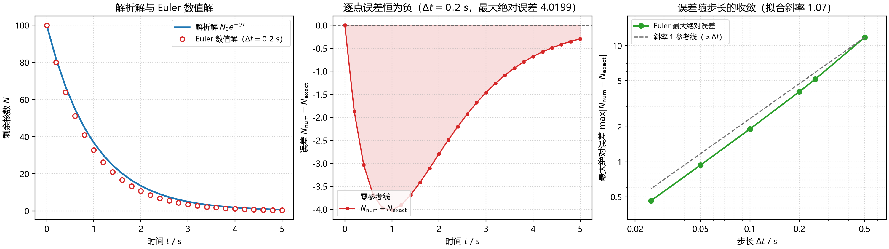

# 练习 1.7：放射性衰变的面向对象实现与误差分析

## 1. 题目

把教材 1.1–1.4 节的放射性衰变 Euler 计算封装成类 `Decay`，用
`@property`（含 setter 校验与"现算"属性）、`@staticmethod`、`@classmethod`
组织代码，并用一张 1×3 图回答三个问题：Euler 误差是系统性的还是随机的？
误差随步长如何变化、能否证明一阶收敛？步长多大时数值解彻底失效？

## 2. 物理模型与数值格式

衰变方程与解析解（教材 (1.1)、(1.2) 式）：

$$
\frac{\mathrm dN_U}{\mathrm dt}=-\frac{N_U}{\tau},
\qquad
N(t)=N_0e^{-t/\tau}.
$$

显式 Euler 格式（教材 (1.3)、(1.4) 式）：

$$
N_{k+1}=N_k-\frac{N_k\Delta t}{\tau}
        =N_k\left(1-\frac{\Delta t}{\tau}\right),
\qquad
t_k=k\Delta t,\quad k=0,1,\dots,n.
$$

因为乘子 $1-\Delta t/\tau$ 为常数，数值解也等于
$N_0(1-\Delta t/\tau)^k$；程序仍按递推逐步计算，以实际调用
`euler_step`，并保持格式可替换。

## 3. 程序结构与接口

```
Decay               封装参数、校验属性、Euler 数值解与解析解
error_sweep()       固定参数、扫描多个步长，得到最大绝对误差
plot_decay()        1×3 面板图（解、误差、log-log 收敛）
self_check()        按作业自查表逐项核对
main()              运行并保存 decay_oop.png
```

| 接口 | 实现 |
| --- | --- |
| `Decay(N0, tau, dt, t_max)` | 构造时经 setter 校验四参数 |
| `d.t` | `@property`，现算 `arange(n+1)*dt` |
| `d.numerical` | `@property`，预分配 ndarray 后逐步调用 `euler_step` |
| `d.exact` | `@property`，在 `d.t` 上取样 |
| `d.error` | `@property`，带符号 `numerical - exact` |
| `d.max_abs_error` | `@property`，现算 `max(abs(error))` |
| `d.half_life` | `@property`，现算 `tau*ln2` |
| `d.N0` / `d.tau` / `d.dt` | `@property` + `@setter`，非正数抛 `ValueError` |
| `Decay.euler_step(n, dt, tau)` | `@staticmethod`，单步 Euler |
| `Decay.from_half_life(N0, t_half, dt, t_max)` | `@classmethod`，`tau=t_half/ln2` |

所有计算属性都从当前参数现算，**不缓存**；`d.dt=0.05` 后
`d.max_abs_error` 自动由 4.0199 变为 0.9394。

主要文件：

| 文件 | 说明 |
| --- | --- |
| `decay_oop.py` | 作业源代码（类、扫描、绘图、自查） |
| `decay_oop.png` | 运行脚本生成的三面板图 |
| `README.md` | 本说明 |

## 4. 运行方法

```bash
pip install numpy matplotlib
python decay_oop.py
```

固定参数 $N_0=100$、$\tau=1\ \mathrm{s}$、$t\in[0,5]\ \mathrm{s}$；
终端打印自查表与分析，并在同目录生成 `decay_oop.png`。

## 5. 计算结果（自查表）

| 检查项 | 期望值 | 实测值 |
| --- | --- | --- |
| 半衰期 $t_{1/2}$ | 0.6931 s | 0.6931 s |
| $\Delta t=0.2$ 时 $N(5)$ | 0.3778 | 0.3778 |
| $\Delta t=0.2$ 时解析解 $N(5)$ | 0.6738 | 0.6738 |
| $\Delta t=0.2$ 时 `max_abs_error` | 4.0199 | 4.0199（峰值在 $t=1\ \mathrm{s}$） |
| $\Delta t=0.05$ 时 `max_abs_error` | 0.9394 | 0.9394 |
| 误差比 $0.5\to0.25$ | 2.29 | 2.2901 |
| 误差比 $0.05\to0.025$ | 2.02 | 2.0214 |
| log-log 拟合斜率 | $1.0\pm0.1$ | 1.071 |
| $\Delta t=2.5$、$t=25$ 时 $\lvert N\rvert$ | 发散，$>10^3$ | 5766.5 |
| 非法参数抛 `ValueError` | 2/2 | 2/2 |
| 改 `d.dt` 后自动更新 | 4.0199→0.9394 | 4.0199→0.9394 |
| `from_half_life` 与 `tau=1` 的相对差 | $<10^{-3}$ | $7.1\times10^{-5}$ |



## 6. 分析题

1. **误差恒为负。** 令 $x=\Delta t/\tau>0$，由 $\ln(1-x)\le -x$ 得
   $(1-x)^n\le e^{-nx}=e^{-t/\tau}$，等号仅在 $t=0$。Euler 每步都比
   $e^{-\Delta t/\tau}$ 少乘一点，数值解系统性偏低，故 `error` 恒负。
   仅在 $\Delta t>\tau$（乘子为负）时符号才交替。

2. **斜率≈1 说明 Euler 是一阶方法。** 局部截断误差为 $O(\Delta t^2)$，
   共 $n\propto1/\Delta t$ 步，累积成全局 $O(\Delta t)$，故 log-log 斜率为 1。
   若改用精确递推 $N_{k+1}=N_ke^{-\Delta t/\tau}$，每步无截断误差，只剩
   $10^{-15}$–$10^{-14}$ 量级的浮点舍入，`max_abs_error` 与 $\Delta t$ 无关，
   右图变为水平线（斜率≈0）。

3. **$\Delta t=2.5\ \mathrm s>2\tau$ 时解发散。** 乘子
   $1-2.5=-1.5$，$|1-\Delta t/\tau|=1.5>1$，每步放大 1.5 倍并变号：
   $N(2.5)=-150$、$N(5)=225$、$N(10)\approx506$、
   $N(25)=100(-1.5)^{10}\approx5766.5$，振荡增长且出现负核数，完全非物理。
   稳定边界为 $|1-\Delta t/\tau|<1$，即 $\Delta t<2\tau$；$\Delta t=2\tau$
   时 $|1-\Delta t/\tau|=1$，为临界等幅振荡。

## 7. 数值方法说明

- **网格**：$n=\lfloor t_{\max}/\Delta t\rfloor$，$t_k=k\Delta t$ 保证
  $t_n\le t_{\max}$；取整时加 $10^{-9}$ 吸收 $5/0.2=24.999\ldots$ 这类
  二进制浮点误差。解析解在**同一组** $t_k$ 上取样，避免误差曲线出现假锯齿。
- **预分配而非 list 拼接**：步数已知，先建 `np.empty(n+1)` 再填值，省去
  `append` 的扩容与最后 `np.asarray` 的复制。
- **绘图**：`matplotlib.use("Agg")` 便于无显示器环境；中文字体回退列表覆盖
  Windows/macOS/Linux；log 轴用 1-2-5 主刻度，其余次刻度只画网格不标字。
