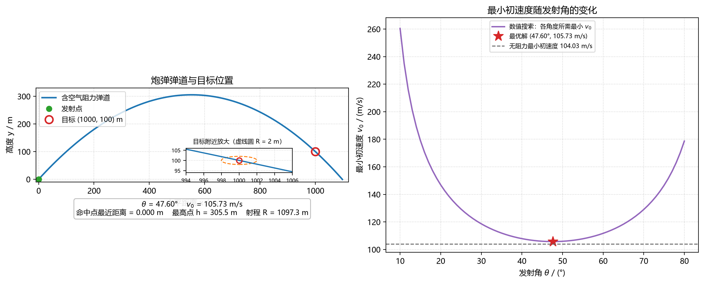

# 抛体运动作业：含二次空气阻力的最佳发射参数

## 1. 题目

炮弹从原点以初速度 $v_0$、发射角 $\theta$ 射出，目标位于
$(x_t,y_t)=(1000\ \mathrm{m},100\ \mathrm{m})$。空气密度随高度按绝热模型变化，
阻力为二次阻力。要求使用**欧拉法**和**类的继承**，寻找命中目标所需的
最小初速度及对应发射角；若有多个方案，取发射角较小者。

题目给定的参数：

| 参数 | 数值 |
| --- | --- |
| 质量 $m$ | $10\ \mathrm{kg}$ |
| $B_2/m$ | $4.0\times10^{-5}\ \mathrm{m^{-1}}$ |
| 重力加速度 $g$ | $9.8\ \mathrm{m/s^2}$ |
| 时间步长 $\Delta t$ | $0.01\ \mathrm{s}$ |
| 密度模型参数 $a$ | $6.5\times10^{-3}\ \mathrm{K/m}$ |
| 地面温度 $T_0$ | $300\ \mathrm{K}$ |
| 绝热指数 $\alpha$ | $2.5$ |
| 搜索范围 | $10^\circ\le\theta\le80^\circ$，$100\le v_0\le1000\ \mathrm{m/s}$ |
| 命中判据 | 与目标距离 $<2\ \mathrm{m}$ |

## 2. 物理模型

$$
v_{x,0}=v_0\cos\theta,\qquad v_{y,0}=v_0\sin\theta,\qquad
v=\sqrt{v_x^2+v_y^2}
$$

绝热空气密度（括号内小于等于 0 时取 $\rho=0$）：

$$
\rho(y)=\rho_0\left(1-\frac{ay}{T_0}\right)^{\alpha}
$$

阻力系数修正与加速度：

$$
B_2^*(y)=B_2\frac{\rho(y)}{\rho_0}
$$

$$
a_x=-\frac{B_2^*(y)}{m}\,v\,v_x,\qquad
a_y=-g-\frac{B_2^*(y)}{m}\,v\,v_y
$$

欧拉法迭代：

$$
x_{i+1}=x_i+v_{x,i}\Delta t,\qquad
y_{i+1}=y_i+v_{y,i}\Delta t
$$

$$
v_{x,i+1}=v_{x,i}+a_{x,i}\Delta t,\qquad
v_{y,i+1}=v_{y,i}+a_{y,i}\Delta t
$$

## 3. 程序结构

```
Projectile                  基类：公共参数 + 欧拉法积分（理想无阻力）
└── AdiabaticDragProjectile 子类：绝热密度模型 + 高度相关二次阻力
```

- `Projectile`：保存 $v_0,\theta,\Delta t,m$ 等公共参数，实现唯一的欧拉迭代
  `simulate()`；其 `acceleration()` 只返回重力加速度，作为无阻力对照。
- `AdiabaticDragProjectile`：重写 `density_ratio()` 和 `acceleration()`，
  计算 $\rho(y)/\rho_0$ 与二次阻力。
- 搜索、二分与主程序只调用 `simulate()`，**不重复编写欧拉迭代**。

主要文件：

| 文件 | 说明 |
| --- | --- |
| `projectile.py` | 作业源代码（类、搜索、绘图、结果输出） |
| `requirements.txt` | 可选绘图依赖（matplotlib）；核心计算只用标准库 |
| `trajectory.png` | 有 matplotlib 时生成的弹道图 |
| `trajectory.svg` | 无 matplotlib 时自动生成的弹道图 |
| `README.md` | 本说明 |

## 4. 运行方法

核心计算与结果输出只使用 Python 标准库，**不需要 numpy**，可直接运行：

```bash
python projectile.py
```

若要生成 PNG 弹道图，安装可选的绘图依赖：

```bash
pip install -r requirements.txt
```

若环境没有 matplotlib，程序会自动改用内置绘图代码输出 `trajectory.svg`，
不会中断计算。绘图标签会优先使用系统中文字体（微软雅黑/黑体/Noto CJK 等），
检测不到时自动切换为英文标签，避免出现方框。

## 5. 计算结果

| 物理量 | 数值 |
| --- | --- |
| 最佳发射角度 $\theta$ | **$47.60^\circ$** |
| 最小初速度 $v_0$ | **$105.73\ \mathrm{m/s}$** |
| 到达目标飞行时间 | **$14.36\ \mathrm{s}$** |
| 落地总飞行时间 | $15.79\ \mathrm{s}$ |
| 最高高度 $h$ | **$305.5\ \mathrm{m}$** |
| 落地射程 $R$ | $1097.3\ \mathrm{m}$ |
| 弹道与目标最近距离 | $<0.01\ \mathrm{m}$（满足 $<2\ \mathrm{m}$） |

按作业要求输出：

```text
最佳发射角度：47.60 °
最小初速度：105.73 m/s
飞行时间：14.36 s
最高高度：305.46 m
```

> 飞行时间按“发射到命中目标”计（$t=14.36\ \mathrm{s}$）；若把弹道继续积分到
> 落地，总飞行时间为 $15.79\ \mathrm{s}$。



## 6. 结果分析

1. **最优角度略小于真空最优角。** 无阻力时最小初速度为 $104.03\ \mathrm{m/s}$、
   最优角 $47.85^\circ$；加入阻力后变为 $105.73\ \mathrm{m/s}$、$47.60^\circ$。
   阻力使射程缩短，必须以略大的初速度补偿；同时降低发射角可以缩短飞行时间、
   减少阻力造成的速度损失，因此最优角向小角度偏移。

2. **密度随高度降低，但本题中影响有限。** 最高点 $y\approx305\ \mathrm{m}$ 处

   $$
   \frac{\rho(h)}{\rho_0}=\left(1-\frac{6.5\times10^{-3}\times305}{300}\right)^{2.5}
   \approx 0.9835,
   $$

   即空气密度只比地面低约 $1.65\%$。出射时阻力加速度约
   $0.447\ \mathrm{m/s^2}$（约 $4.6\%g$），最高点处约
   $0.190\ \mathrm{m/s^2}$（约 $1.9\%g$）。

3. **高度效应的方向。** 由于 $\rho(y)$ 随高度递减，炮弹在高处的阻力小于
   地面值，弹道被“削短”的程度比假设密度恒为 $\rho_0$ 时更弱；若把密度
   当作常数，所需初速度会更大、射程会更短。本题弹道高度只有三百米量级，
   密度仍为地面的 $98\%$ 以上，所以高度修正很小，结果接近真空弹道，
   仅表现为初速度增加约 $1.6\%$、最佳角减小约 $0.25^\circ$。

## 7. 数值方法说明

- **积分**：固定步长显式欧拉法，$\Delta t=0.01\ \mathrm{s}$；落地时在最后
  两个时间步之间线性插值得到射程与总飞行时间。
- **命中判定**：把弹道看成折线，计算目标点到各线段的距离并取最小值，
  避免只检查离散节点而漏掉两步之间的最近点。搜索时直接求穿过目标中心
  （最近距离 $\approx0$）的解，再复核 $<2\ \mathrm{m}$ 判据；若严格贴着
  $2\ \mathrm{m}$ 边界取最小速度，结果约为 $105.59\ \mathrm{m/s}$，
  与本文相差仅 $0.14\ \mathrm{m/s}$。
- **最小初速度搜索**：固定发射角时，弹道在 $x=x_t$ 处的高度随 $v_0$ 单调
  上升，因此对 $y(x_t)-y_t$ 的符号做二分；收敛后用完整弹道复核最近距离。
- **角度搜索**：先在 $10^\circ$–$80^\circ$ 以 $0.5^\circ$ 粗扫，再在最优点
  附近以 $0.05^\circ$ 细化。升序扫描且用严格小于比较，保证多解时取较小角。
